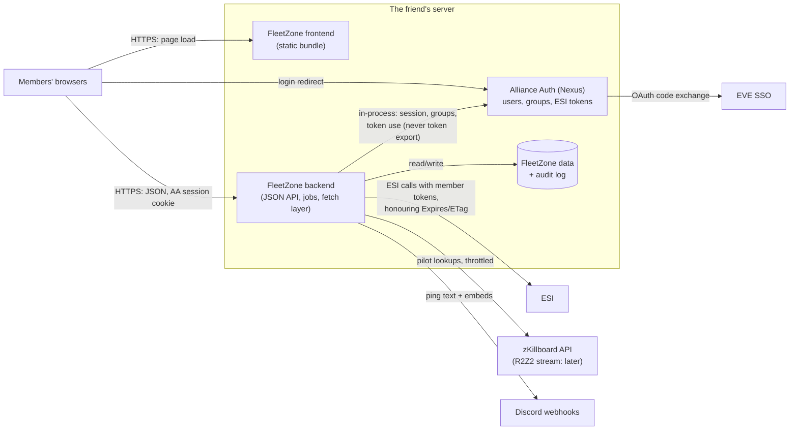
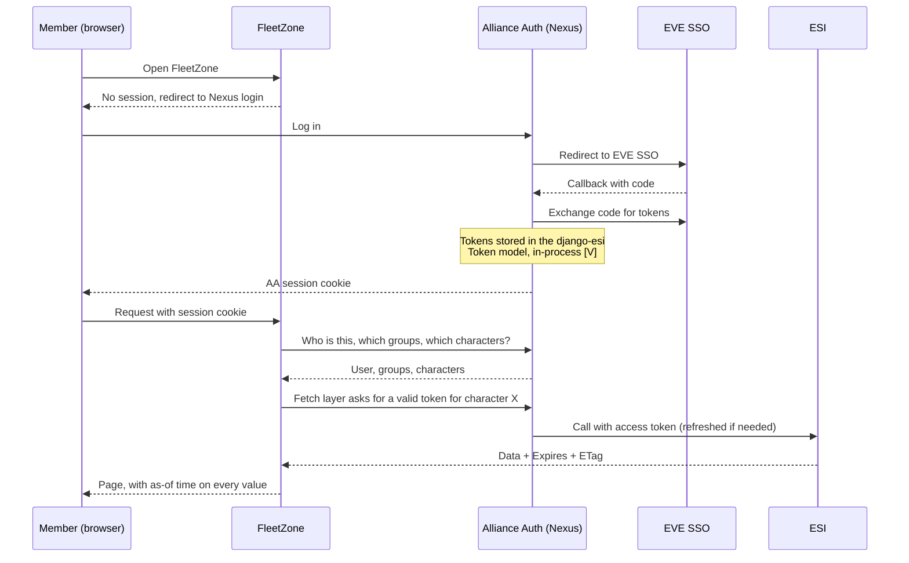

# FleetZone Mechanics

**Target:** `docs/MECHANICS.md`
**Audience:** the builder (a developer, not an EVE expert) and the owner.
**Status:** design description, not code. Nothing here has been tested against a real Alliance Auth instance, because the dev instance does not exist yet.

**Tags**

| Tag | Meaning |
|---|---|
| [V] | Verified in the research from a named source. Several rest on third-party mirrors, so check them against CCP primary docs before relying on them. |
| [U] | Unverified. Treat as a lead and test it. |
| [D] | A design choice proposed here. The builder may change it. |

Terms: **Nexus** is the alliance's Alliance Auth (AA) install. **ESI** is CCP's API for EVE data. **SDE** is CCP's static data export (ship, module and skill definitions). **FC** is a fleet commander.

---

## 1. Purpose and users

FleetZone is an in-house web app for one alliance. It answers four questions quickly:

- Who can fly our doctrine, and who showed up?
- What is hostile near me?
- Where does our wormhole chain go?
- What timers and notifications need attention?

It is not public and has no paid features (the CCP licence is non-commercial [V]).

### Roles

Roles come from AA groups; FleetZone keeps no separate user list. The group names below are proposals [D], and the builder maps them to whatever groups Nexus really has.

| Role | Proposed AA group [D] | Can see | Can do |
|---|---|---|---|
| Recruit (staged onboarding) | `Member`, joined less than 30 days ago | Own characters, own readiness, doctrine list | Nothing else: no intel, no chain map |
| Member | `Member` | Intel, chain map, doctrines, own readiness, own dashboard | Report intel, paste signatures, edit connection state |
| FC / fleet boss | `FC` | All of the above, plus alliance readiness tables, attendance sheets and the timer board | Start fleet tracking, send pings, correct attendance, confirm intel for broadcast |
| Director / admin | `Director` | Everything except other members' private dashboards | Enable modules, manage doctrines, webhooks and role mapping, confirm signature deletes by others |
| Auditor | `FleetZone Auditor` | Audit log and role assignments, read-only | Export the log (the export is itself logged) |

Rules [D]:

- Access is denied by default. A user with no mapped group sees a "no access" page.
- Roles are additive. An FC is also a member.
- The auditor role grants no live intel or chain access. This limits the damage from one over-trusted account.
- No shared accounts. Every action ties to one AA user.

---

## 2. System context

The plan recommends integration mode (a): FleetZone's backend is a Django app running inside AA, serving a JSON API to a separately built frontend [D]. The diagram shows that mode. Mode (b), an external service plus a small bridge app in AA, changes only the arrow between backend and AA.

What crosses each boundary:

| Boundary | Crosses | Never crosses |
|---|---|---|
| Browser ↔ FleetZone | Session cookie, JSON, pasted text | ESI tokens, raw chat logs |
| FleetZone ↔ AA | User identity, groups, token use in-process [V] | Tokens leaving the AA process |
| FleetZone ↔ ESI | Authenticated reads | Writes (v1 uses no write scopes) |
| FleetZone ↔ zKillboard | Character and corp IDs for lookup | Scraping; API only [V] |
| FleetZone ↔ Discord | Ping content | Webhook URLs to the browser (they are secrets) |

Two notes:

- **R2Z2** is zKillboard's replacement for the RedisQ kill stream, which was sunset on 31 May 2026 [V]. A live kill stream is cut from v1. If added later, it is built on R2Z2 with a cursor.
- **Shared budget.** In mode (a), FleetZone and Nexus share one ESI client and one rate budget. FleetZone can therefore break Nexus if it misbehaves, which section 6 addresses.

---

## 3. Login and consent

In mode (b), the browser logs in through the AA OIDC plugin (`/o/authorize/`, `/o/token/`, `/o/userinfo/`, with a groups claim) [V]. FleetZone then asks a bridge app inside AA for ESI data, never for tokens [D]. Whether that plugin is installed on Nexus is unknown.

### What consent means now

The plan assumed FleetZone would request scopes per module. That is obsolete, because members have already granted all scopes in Nexus. No second EVE consent screen appears.

Consent therefore moves from "may FleetZone get a token" to "what FleetZone does with tokens that already exist":

1. **Scope allow-list [D].** Each module declares the scopes it uses. The fetch layer refuses any call outside the declared set. FleetZone can technically reach wallet, assets and mail, but it never reads them.
2. **First-run notice [D].** On first login the member sees one page listing, per enabled module, which of their data is read and who can see it. They acknowledge it once, and the acknowledgement is logged.
3. **Per-character opt-out [D].** A member can exclude a character from readiness and dashboard reads. That character shows as "opted out", never as "not ready".

### What a lapsed token looks like

A token lapses when the member revokes the app in CCP's account settings, when AA drops it after a failed refresh, or when the character was never added to Nexus.

To the user [D]:

- A banner on their own pages: "Character X: token lapsed since [time]. Re-add it in Nexus." The link goes to Nexus, not to FleetZone.
- In tables others see, the row reads "token lapsed" with the last good as-of time. It is greyed, counted in neither ready nor not-ready, and included in the coverage figure.
- Three states stay distinct everywhere: **no token**, **token lapsed** and **opted out**. None of them ever renders as a zero or a failure.

---

## 4. Module mechanics

### 4.1 Fleet ops

**Purpose:** show who can fly the alliance's doctrines, call them to a fleet, and record who came.

**User flow**

1. A director opens Fleet ops → Doctrines → New and names the doctrine.
2. They paste one or more fits in EFT format (the game's clipboard format: `[hull, fit name]`, then blank-line-separated module sections, drones as `Name xN`) [V].
3. FleetZone shows a parse preview: hull, modules by slot, and any unrecognised lines highlighted. The director saves.
4. An FC opens the doctrine and sees the readiness table: one row per character, one column per fit.
5. The FC clicks Ping, picks a channel, edits the text and sends.
6. Once in fleet in-game, the FC clicks Start tracking. Snapshots begin.
7. The FC clicks Stop tracking. The attendance sheet appears and can be corrected.

**Empty state:** with no doctrines, members see "No doctrines yet" and directors see a paste box. With no tracked fleets, the attendance tab explains how tracking starts.

**Error state:** an EFT paste with an unknown hull is rejected with the offending line shown. Unknown module lines are kept as warnings and the fit is saved as "incomplete" [D].

**Inputs**

| Data | Source | Freshness |
|---|---|---|
| Fits | Pasted EFT text | Static until edited |
| Skill requirements | SDE, pinned build | Static per build |
| Character skills | ESI, `esi-skills.read_skills.v1` | About 120s cache [V] |
| Fleet members | ESI, `esi-fleets.read_fleet.v1` | 5s cache [V] |

**Outputs:** the readiness table with a coverage line, the ping delivery result, and the attendance sheet. Every row carries its as-of time.

**Readiness calculation**

1. For the hull and every module in a fit, read the required skills from the SDE. Skill type IDs are dogma attributes 182, 183, 184, 1285, 1289 and 1290; their required levels are attributes 277, 278, 279, 1286, 1287 and 1288. There are up to six pairs per item [V].
2. Merge across the fit: for each skill, keep the highest required level [D].
3. For each required skill: **gap = max(0, required level − active level)** [V].
4. Use the *active* level, not the trained level. Active is lower for Alpha clones and can differ with Expert Systems [V]. Show both when they differ.
5. A skill missing from the character's list counts as level 0 [V].
6. A fit is **Ready** when every gap is 0. Otherwise show the count of skills short and the list [D].
7. Coverage is shown next to every aggregate, for example "41 ready of 58 with data; 9 lapsed; 3 opted out" [D].

Skill-queue ETA ("ready in 3 days") is cut, because the queue schema is [U].

**Attendance provenance**

- While tracking, FleetZone reads the fleet member list every 60s [D]. The cache floor is 5s [V]; the slower rate saves shared budget.
- Whether the read needs the fleet boss's own token is [U]. Default: tracking uses the token of the FC who clicked Start, and fails with a clear message if ESI refuses [D]. How the app finds the fleet ID is part of the same Phase 0 test.
- Each row stores character, first seen, last seen, snapshots seen out of snapshots taken, ship at last sighting, and **provenance**: `fleet snapshot`, `manual` or `rsvp` (reserved; RSVP is not a v1 source).
- A character seen in at least one snapshot is "present" [D].
- A character not on the sheet has **no record**. FleetZone never prints "no-show", because a failed snapshot or an early departure looks identical [V for the ambiguity].
- FC corrections add or remove rows. The original row is kept, marked with corrected-by and time, and an audit event is written.

**Failure modes**

| Failure | What the user sees |
|---|---|
| Skills read fails for one character | That row keeps its last value, with a stale badge and as-of time |
| Token lapsed | "Token lapsed" row, excluded from counts |
| SDE lacks an item (newer than the pinned build) | Fit marked "incomplete: unknown item", readiness shown as partial |
| Fleet read refused or FC left fleet | Tracking pauses; banner "Tracking paused at [time]: [reason]"; the gap is marked on the sheet |
| Webhook dead | See section 7 |

---

### 4.2 Intel

**Purpose:** turn what a pilot sees in local or intel chat into a shared, ageing picture of nearby systems.

ESI has no endpoint for chat, pings or intel [V]. Everything here starts with a human paste.

**User flow**

1. The member opens Intel. The map centres on their current system.
2. They copy the local member list or some chat lines in-game and click Paste report (or press Ctrl+V with the panel focused). The clipboard is read only on that action, never silently.
3. FleetZone parses the names, drops own-alliance pilots, and shows a triage preview.
4. The member confirms the system (prefilled from their location) and clicks Report hostile or Report clear.
5. The system's status changes for everyone, with reporter, source and age shown.
6. With no further input, the status decays (below).

**Empty state:** "No reports in range. Systems show as unknown." Unknown is the normal resting state, not an error.

**Error state:** a paste that yields no names shows "Nothing recognised" with the raw text left in the box for editing. Nothing is submitted.

**Inputs**

| Data | Source | Freshness |
|---|---|---|
| Sightings | User paste | Instant |
| Reporter's system | ESI, `esi-location.read_location.v1` [V via mirror] | Per the response's `Expires` header |
| Pilot background | zKillboard API | Cached locally 1h [D]; zKill quotas are [U], so throttle hard |
| Map topology | SDE | Static |

Resolving pasted names to character IDs needs a lookup that the research did not cover [U]. The builder confirms the endpoint in Phase 0.

**Outputs:** the map, a report feed and a per-system detail panel. Each report shows reporter, source (`paste`, `picker` or `companion`), verification label and age.

**Tri-state decay**

Every system is **clear**, **unknown** or **hostile**. The tri-state model is fixed; the numbers below are proposals [D], configurable by a director.

| Event | New state | Holds for |
|---|---|---|
| Hostile report | Hostile | 10 minutes from the latest hostile report |
| Clear report | Clear | 5 minutes from the latest clear report |
| Hold time ends | Unknown | Until the next report |

- A new report of the same kind resets the timer. A report of the other kind replaces the state.
- The UI shows the remaining hold as a shrinking bar, so decay is visible without a refresh.
- Clear decays faster than hostile on purpose: a false "clear" is the more dangerous error.
- Decay is computed from a stored deadline, not by a job that must run on time [D].

**Threat triage [D]**

Each pasted pilot gets one label:

- **Friendly:** in the alliance according to AA. Dropped from the count.
- **Watchlisted:** on a director-maintained list of pilots, corps or alliances.
- **Active:** zKillboard shows recent kill activity. The exact fields and thresholds are set after reading zKill's API docs.
- **Unknown:** no data, or the lookup failed.

The headline is counts per label. A failed lookup yields Unknown, never "safe".

**Ego-centric map [D]**

The map shows the user's system at the centre and every system within 5 gate jumps, laid out by jump distance. It re-centres when the location read changes. A user can pin a different centre.

**Ingestion extras**

- The Chromium directory picker (reads `Chatlogs` and `Gamelogs` as UTF-16LE, polls file size and mtime, parses in a Web Worker, uploads only derived sightings) [V] is off by default. Log parsing is tolerated by the community but has no published CCP permission.
- A companion app is considered only if the gate fails. The gate is that a sighting reaches other users within 30s [D].

**Failure modes**

| Failure | What the user sees |
|---|---|
| zKill slow or down | Report still posts; pilots labelled Unknown; note "background check unavailable" |
| Location read fails or lapsed | Map keeps its last centre with a stale badge; the system must be picked by hand |
| Two conflicting reports within a minute | The latest wins; both stay in the feed; the system shows "contested" for 2 minutes [D] |
| Backend unreachable | The paste stays in the box with "Not sent. Retry." Nothing is lost silently |

---

### 4.3 Chain mapper

**Purpose:** keep one shared, honest map of the wormhole chain, built from what scanners paste.

No shared chain API exists between mapper tools, so data is entered by the alliance's own scanners.

**User flow**

1. The member opens Chain mapper and picks or creates a map.
2. They select a system (prefilled from their location).
3. In-game they copy the probe scanner results (tab-separated rows: signature ID, group, type [V]) and click Paste signatures.
4. FleetZone shows a preview with three lists: **New**, **Updated**, **Missing**.
5. The member reviews and clicks Apply. New and Updated are saved. Missing rows stay unless the member ticks them for deletion.
6. For a wormhole signature, the member clicks it, picks the type code, and sets mass and lifetime state from the in-game Show Info text.
7. After jumping through, they link the far-side system. The connection appears on the map.
8. Route: pick origin and destination, and get a path.

**Empty state:** "No signatures recorded for this system. Paste scanner results to begin."

**Error state:** rows that do not match the expected column layout are listed as "skipped" with the raw line. Valid rows still preview.

**Inputs**

| Data | Source | Freshness |
|---|---|---|
| Signatures | User paste | Instant |
| Wormhole type data (codes such as O477, C247) | SDE, pinned build [V] | Static per build |
| Mass and lifetime state | Manual, from Show Info text | As of the last edit, shown with editor and time |
| K-space gates | SDE | Static |

**Signature paste diff**

Records are keyed by system, signature ID and downtime epoch.

| List | Rule | On Apply |
|---|---|---|
| New | ID in paste, not in store | Created |
| Updated | ID in both, and the paste has more or different group/type | Updated; a known value is never overwritten with a blank [D] |
| Missing | ID in store, not in paste | Kept, marked "not seen in last paste by [user] at [time]"; deleted only if ticked [V for no auto-delete] |

- Deletes are audited. A delete of a signature someone else created less than 10 minutes ago asks for confirmation [D].
- **Downtime.** Whether the daily server restart re-issues signature IDs is [U]. The safe default is that an ID seen after downtime is a new record even if the text matches an old one. Old records are shown as "pre-downtime" until someone clears them.
- Two users pasting the same system converge, because each Apply is a merge and never a replace.

**Mass states** (from Show Info text; independent of lifetime) [V]

| State | Remaining mass |
|---|---|
| Fresh | More than 50% |
| Reduced | 50% to 10% |
| Critical | Less than 10% |

**Lifetime states** [V from a third-party guide; verify]

| State | Remaining life |
|---|---|
| Fresh | More than 24h |
| Beginning to decay | 24h to 4h |
| End of life (EOL) | Less than 4h |
| Expired | Gone |

**Auto-ageing [D]**

- When a user sets a lifetime state, the time is stored (`flagged-at`).
- A connection flagged "beginning to decay" moves to EOL 20 hours after the flag. That is the longest it could still have had more than 4h left.
- A connection flagged EOL shows "likely expired" 4 hours after the flag. It is not set to Expired and not deleted. Expired is manual only [V for the policy]. One other mapper deletes EOL edges 4h15m after the flag [V]; FleetZone deliberately does not.
- Mass never auto-changes. Only a person who read Show Info sets it.
- Colour or wobble seen in space is a hint for the human. The app never derives state from it [V].
- A K162 (the generic far-side code) stays "unresolved" until someone visits the other side and records the real type [V].

**Routing**

- The graph is chain connections plus k-space gates. The cost is jump count [D]; the routing details are [U].
- EOL and Critical connections are excluded by default. A visible toggle includes them [V for the policy].
- "Likely expired" and Expired connections are always excluded.
- An avoid-system list is supported.
- The route lists every hop with the connection's state and its as-of time, so a pilot can judge an old edge.

**Failure modes**

| Failure | What the user sees |
|---|---|
| Unknown type code | Free-text code accepted, flagged "not in SDE build N" |
| Two users edit the same connection | Last write wins; both edits in history; a toast: "Changed by [user] just now" |
| No route under the filters | "No route with current filters", with a one-click retry including EOL/Critical |
| Location read lapsed | The system must be picked by hand; everything else works |

---

### 4.4 Character and corp dashboard

**Purpose:** give each member one view of their characters, and give leadership one board of structure timers.

**User flow**

1. The member opens Dashboard. A card per character shows location, ship, online state and a skills summary.
2. The Notifications tab lists recent in-game notifications per character.
3. FCs and directors see a Timers tab: every corp structure with a pending timer, soonest first.
4. Clicking a timer shows its source, the raw values and the as-of time.

**Empty state:** "No characters found in Nexus for your account", with a link to Nexus. The timer board shows "No pending timers as of [time]", and the time matters there.

**Error state:** a card that cannot load shows which read failed and when it last succeeded. Other cards are unaffected.

**Inputs**

| Data | Source | Freshness |
|---|---|---|
| Location, ship, online | ESI location scopes [V via mirror; confirm] | Per `Expires` |
| Skills | ESI | About 120s [V] |
| Notifications | `/characters/{id}/notifications/` | 600s [V] |
| Structures | Corp structures endpoint: `state`, `state_timer_end`, `fuel_expires`, `unanchors_at` [V] | Per `Expires` |

Which in-game corp role the reading character needs for structure data was not researched [U]. A director nominates the character.

**Notification parsing**

The notification `text` field is YAML with inconsistent field names [V]. The rules:

- Parse defensively, per type, for a short MVP list of types.
- An unknown type or a failed parse renders as raw text with its type name. It never crashes the feed.
- Whether raw YAML is stored or only the parsed fields is an open question (section 10).

**Timer display**

| Timer kind | Field | Shown as |
|---|---|---|
| Reinforcement | `state_timer_end` plus `state` | State name, countdown, absolute EVE time |
| Fuel | `fuel_expires` | Countdown; amber under 7 days, red under 48h [D] |
| Unanchoring | `unanchors_at` | Countdown, absolute EVE time |

- All absolute times are in EVE time (UTC), with local time on hover [D].
- Countdowns tick in the browser from the stored end time. The as-of stamp shows when that end time was last read.
- A timer whose end has passed stays for 1 hour, marked "passed" [D], and then leaves the board.

**Failure modes**

| Failure | What the user sees |
|---|---|
| Structure read refused (role or token) | Board banner: "Structure data unavailable since [time]: [reason]"; the last timers are kept, marked stale |
| Notification YAML unparseable | Raw text row |
| One character lapsed | That card shows "token lapsed"; the others are normal |

---

## 5. Modular UI

All four modules ship in v1. Each can be switched on or off for the whole alliance by a director.

**Defaults [D]:** Fleet ops and Intel on; Chain mapper and Dashboard off until a director enables them. This is the fleet-first set from the plan.

### The module manifest [D]

Each module is a folder with one manifest. The shell reads the manifests at start and builds everything else from them.

| Manifest field | Meaning |
|---|---|
| `id`, `name`, `icon` | Identity and nav entry |
| `default_enabled` | The default above |
| `routes` | Frontend pages and API paths, all under `/m/<id>/` |
| `permissions` | Named permissions (for example `fleet.ping`, `chain.delete_signature`) and the roles that hold them by default |
| `scopes` | ESI scopes the module may use; the fetch layer enforces this list |
| `entities` | Data tables the module owns |
| `jobs` | Scheduled reads, each with its cache floor |
| `notifications` | Trigger names the module can raise |
| `depends_on` | Other modules or shared services it needs |

### What disabling does [D]

- The nav entry and all pages disappear. Direct URLs show "module disabled".
- The module's API paths return 404.
- Its scheduled jobs stop, so it makes no ESI calls.
- Its notification triggers stop firing.
- Its data is kept, not deleted. Re-enabling shows old data with its old as-of times, clearly stale.
- The toggle writes an audit event.

A member may also hide an enabled module from their own nav. That is a display preference and changes nothing server-side.

Modules never call each other's internals. Shared services (auth, the fetch layer, audit, notifications, SDE) live in the shell.

---

## 6. Data freshness and the as-of rule

**Rule: every displayed value that came from outside carries the time it was fetched.** This is necessary because ESI is cache-driven, not push [V]. A number without a time misleads.

Display [D]:

- Tables: an "as of" column or a per-row tooltip, plus one line for the oldest value in view.
- Single values: relative age next to the value ("2m ago"), absolute EVE time on hover.
- A value older than twice its cache floor gets a **stale** badge.
- Notifications sent to Discord include the as-of time in the text.

**Cache floors [V]**

| Data | Floor |
|---|---|
| Fleet members and wings | 5s |
| Skills | About 120s |
| Fittings | 300s |
| Notifications | 600s |

Fetch layer rules:

- One layer for all modules. No module calls ESI directly.
- Honour `Expires` and `ETag`. Never request before `Expires`; that is a ban risk [V].
- Track both rate systems [V]: the legacy error budget (about 100 non-2xx responses per minute, then a 420 response) and the per-route-group token buckets (2xx costs 2, 3xx costs 1, 4xx costs 5, 5xx costs 0), read from the `X-Ratelimit-*` headers.
- A circuit breaker halts a route group before the budget empties and leaves headroom for Nexus's own jobs.

**During an outage** (ESI down, breaker open or Nexus unreachable) [D]:

- A top banner names what is affected and since when.
- Pages keep showing the last data with stale badges. Nothing blanks out.
- No status is derived from a failed read. A failure is "no data", never "not ready", "absent" or "clear".
- Paste-driven features (intel reports, signatures) keep working, because they do not depend on ESI.
- Scheduled jobs resume on their own when the breaker closes.

---

## 7. Notifications and pings

**Channels:** Discord webhook first. Web Push is optional and off in v1 [D].

**Triggers [D]**

| Trigger | Raised by | Default target |
|---|---|---|
| Fleet ping | FC, manually | Chosen webhook |
| Hostile intel broadcast | Verified report, or FC confirmation | Intel webhook |
| Structure enters a reinforced state | Dashboard job | Leadership webhook |
| Fuel under 7 days, then under 48h | Dashboard job | Leadership webhook |
| Webhook died | Notification service | In-app alert to directors |
| Own token lapsed | Fetch layer | In-app banner to that member only |

**Discord limits [V]**

- Content is 2000 characters, with 10 embeds and 6000 combined embed characters. Longer messages are truncated with a link back to FleetZone.
- There is no fixed per-webhook rate. Read the `X-RateLimit` headers and queue.
- A 404 means the webhook is dead: disable the channel, stop sending and alert a director.
- Never retry an invalid request in a loop. Discord's ban budget is 10,000 invalid requests per 10 minutes per IP, and that IP is shared with Nexus.

**Quiet behaviour [D]**

- The same trigger for the same subject fires at most once per 10 minutes. Repeats are folded into "+3 more reports".
- Automatic triggers never use `@everyone`. Only a manual FC ping may.
- Each webhook has a director-set cap per hour. Over the cap, messages are dropped with an in-app note, not queued forever.
- Every send records its delivery result, visible to the sender.

**Web Push, if enabled later:** it needs HTTPS, a service worker, VAPID keys and `userVisibleOnly` [V]. Payloads stay under about 3.5 KB (hard ceiling 4096 bytes) [V], so they carry an ID and summary and the page fetches the rest. The subscription endpoint is a secret [V].

---

## 8. Audit and opsec

**What is logged** (append-only; no edit, no delete):

- Logins and first-run acknowledgements.
- Role mapping changes and module toggles.
- Intel reports, edits and broadcast confirmations.
- Attendance corrections.
- Signature deletes and connection state changes.
- Doctrine edits, and webhook creation or removal.
- Exports and audit-log reads [D].

Each event stores who, when, what, and the before and after values.

**Who can read it [D]:** auditors and directors. Reading is logged, so the auditor is audited too.

**Intel-poisoning defences [D]**

- **Reporter reputation.** Each reporter has two counts: reports later confirmed by another reporter or by an FC, and reports contradicted within their hold time. A reporter is "trusted" after 10 confirmed reports with under 20% contradicted. Recruits cannot report.
- **Cross-check before broadcast.** A hostile report goes to Discord only if the reporter is trusted and their ESI location matches the reported system, or a second member reports the same system within 5 minutes, or an FC confirms it.
- **Unverified labels.** Reports that fail the check still appear in the app, labelled "unverified". They change the map but never trigger a ping.
- zKillboard data informs triage only. It never verifies a report on its own.

**What changes now that all scopes are granted**

- The risk moves from "members will not consent" to "FleetZone can reach far more than it needs". The per-module scope allow-list (section 3) is the main control.
- A compromise of FleetZone is a compromise of everything Nexus holds. In mode (a) tokens never leave the AA process [V]; keep it that way. No endpoint returns a token, and no log line contains one.
- Location and online status are sensitive. A member's dashboard is visible only to that member [D].
- Readiness coverage should be high, so low coverage now signals lapsed tokens rather than refusal.

**Licence duties [V]:** the footer carries the notice "© 2014 CCP hf. All rights reserved. EVE, EVE Online, CCP, and all related logos and images are trademarks or registered trademarks of CCP hf." plus a non-affiliation line. The friend, as operator, owns the kill-switch runbook: stop hosting, revoke ESI, and purge cached game data within 5 business days of termination.

---

## 9. Out of scope for v1

| Cut | Why |
|---|---|
| SRP (ship replacement) | AA already has it |
| Fleet invites and moves, pushing fits to the client | They need write scopes; v1 is read-only |
| Skill-queue ETA | Schema is [U] |
| Calendar RSVP as an attendance source | Depends on the event owner's token; ambiguous absences |
| Live killmail stream | RedisQ is gone; R2Z2 limits are partly [U] |
| Automatic log tailing by default; companion app | No published CCP permission; considered only if the 30s gate fails |
| Dotlan data | No API; permission [U] |
| Thera/Turnur shortcut routing | Eve-Scout reuse terms are [U] |
| Import from other mapper tools | No shared API exists |
| Wallet, assets, industry | Other tools cover them, and they widen the data surface |
| Coalition sharing | In-house app; the single-alliance trust model is simpler and safer |
| Web Push | Discord is enough for v1 |

---

## 10. Open questions for the friend

Each default applies unless the friend changes it.

| # | Question | Default |
|---|---|---|
| 1 | Integration mode: plugin inside AA (a), external app plus bridge (b), or own SSO (c)? | (a), with core logic kept framework-free |
| 2 | Is the OIDC plugin installed on Nexus? | Assume no; this matters only for (b) |
| 3 | When does the AA dev instance exist? | Until then, build only parsers, the gap calculator, the SDE import and the UI shell |
| 4 | Does a fleet-member read need the fleet boss's token? [U] | Use the tracking FC's token; test in Phase 0 |
| 5 | Which AA groups map to the five roles? | The table in section 1 |
| 6 | Headline readiness on active or trained level? | Active, with trained shown |
| 7 | Attendance source of truth? | Fleet snapshot plus FC correction |
| 8 | Snapshot interval while tracking? | 60s |
| 9 | Decay times for hostile and clear? | 10 and 5 minutes |
| 10 | Map radius? | 5 jumps |
| 11 | Do post-downtime signature IDs count as new? [U] | Yes, until verified |
| 12 | Store raw notification YAML? | No; parsed fields only, raw text for unknown types |
| 13 | Which notification types and timers are in the MVP? | Structure reinforcement, fuel, unanchoring |
| 14 | Which character reads corp structures, and what role does it need? [U] | A director nominates one; verify on the dev instance |
| 15 | Web Push in v1? | No |
| 16 | Is the directory picker enabled? | Off; a director can enable it per alliance |
| 17 | How much ESI headroom is reserved for Nexus? | The breaker opens at half the remaining budget |
| 18 | Do co-hosted apps share an ESI error budget by IP? (Missing fact.) | Assume yes |
| 19 | zKill lookup rate? [U] | One request per second, cached 1h |
| 20 | Staged onboarding window? | 30 days as Recruit |
